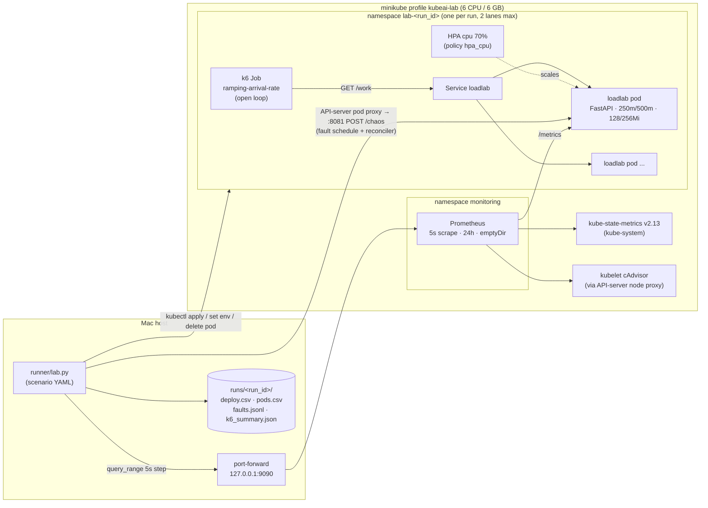

# loadlab — autoscaling & remediation ground-truth lab

The old kube AI agent only watched memory, and its only label was "pod already crashed". loadlab
generates **labelled, realistic telemetry** for the redesign. The redesigned agent decides scaling and
remediation from the four signal groups Kubernetes autoscaling uses:

| group | signals (CSV columns) |
|---|---|
| compute | `cpu_cores_used`, `cpu_util_vs_request`, `throttle_ratio` (CFS throttled / total periods) |
| memory | `mem_ws_bytes_total`, `mem_ws_max_pod_frac_of_limit`, `mem_growth_bytes_per_s`, `restarts_total`, `oomkills_total` |
| traffic | `rps`, `inflight` |
| request quality | `p50`, `p95`, `p99` (seconds), `error_rate` (5xx share) |
| state | `replicas_desired`, `replicas_ready`, `crashloop_pods`, `hpa_desired` |

**SLO:** p95 < 300 ms and error rate < 1 %.

The point of the lab is to separate **"needs more replicas"** (saturation: CPU near limit, throttling,
in-flight and latency rise with RPS) from **"broken, scaling won't help"**: memory leak (mem grows to
the limit → OOMKill, independent of RPS), slow dependency (latency up, CPU flat or *down*), bad deploy
(CPU per request jumps at a rollout), crashloop (CrashLoopBackOff, ready < desired), 5xx bursts and
in-container CPU hogs. Each fault is applied at an exact time and logged in `faults.jsonl`, the
ground truth.



## Layout

```
loadlab/
  app/            FastAPI service (main.py, Dockerfile, requirements.txt)  -> image loadlab:v1
  k8s/            app.yaml (Deployment+Service), hpa.yaml, k6-job.yaml   (string.Template-rendered)
  monitoring/     prometheus.yaml, kube-state-metrics.yaml, deploy.sh, port-forward.sh
  load/shapes.js  k6 traffic shapes
  scenarios/      declarative scenario specs (YAML)
  runner/         lab.py (runner), promexport.py (PromQL → CSV), calibrate.py (capacity probe → calibration.json)
  calibration.json  measured per-pod capacity
  runs/<run_id>/  outputs (one dir per run)
```

## Quick start

```bash
cd k8s_aiAgent/loadlab
PY=/Users/vaibav/kubeai-work/.venv/bin/python        # needs pandas, requests, pyyaml
minikube -p kubeai-lab image build -t loadlab:v1 app/
monitoring/deploy.sh                                    # Prometheus + kube-state-metrics
nohup monitoring/port-forward.sh >/tmp/prom-pf.log 2>&1 &   # Prometheus on 127.0.0.1:9090
$PY runner/lab.py scenarios/capacity_probe.yaml         # 1 pod, step ramp (~9 min)
$PY runner/calibrate.py runs/<capacity-probe-run-id>    # -> calibration.json
$PY runner/lab.py scenarios/smoke.yaml                  # 5 min end-to-end smoke
$PY runner/lab.py --lanes 2 scenarios/fixed_spike.yaml scenarios/hpa_diurnal.yaml   # 2 concurrent lanes
$PY runner/promexport.py runs/<run_id>                  # re-export a run (Prometheus keeps 24h)
```

> **Use `127.0.0.1:9090`, not `localhost:9090`.** On this Mac another (node) process listens on
> `[::]:9090`, and `localhost` resolves to `::1` first. The runner uses `PROM_URL` (default
> `http://127.0.0.1:9090`) and starts the port-forward itself if Prometheus is unreachable.

## 1. The app (`app/`)

* `GET /work` burns `CPU_MS_PER_REQ` ms (default 25) of real CPU, measured with `time.thread_time()`,
  so wall time stretches under CFS throttling. It also allocates and frees `ALLOC_KB` (default 64) of
  memory. The CPU part runs on a 2-thread pool (`WORKERS`) inside one uvicorn worker; requests
  beyond that wait on a semaphore inside the timed region, so the latency histogram includes real
  queueing delay as the pod saturates.
* **Server-side deadline** `REQUEST_TIMEOUT_S` (default 10 s): a request that cannot finish in time
  is answered `504` (like a gateway/upstream timeout). This makes user-visible overload show up in
  `error_rate`; k6's client timeout is 12 s so the server always answers first.
* Metrics come from a pure-ASGI middleware, so a request is timed from its arrival on the event loop,
  which the CPU work never blocks:
  `http_requests_total{code}`, `http_request_duration_seconds` (22 buckets 5 ms…10 s, dense at
  100–500 ms), `http_inflight_requests`, plus `loadlab_leaked_bytes` and `loadlab_chaos{knob}`.
  Only `/work` is instrumented, so probes do not dilute RPS.
* Fault switches: `POST /chaos` with JSON. It is served on `:8080/chaos` and also on an admin thread
  at `:8081/chaos`, which the runner uses because it answers even when the pod is saturated.
  Every knob also has an env default:

| knob | env | effect |
|---|---|---|
| `leak_kb_per_s` | `LEAK_KB_PER_S` | retained memory grows → OOMKill at the 256Mi limit |
| `dep_latency_ms`, `dep_fraction` | `DEP_LATENCY_MS`, `DEP_FRACTION` | slow downstream (sleep, no CPU) on a fraction of requests |
| `error_rate` | `ERROR_RATE` | share of requests answered 500 |
| `cpu_hog_millicores` | `CPU_HOG_MILLICORES` | child process burning CPU in the same cgroup |
| `reset: true`, `free_leak: true` | – | clear all / release leaked memory |
| – | `CRASH_ON_START=1` | exit(3) at start → CrashLoopBackOff |
| – | `CPU_MS_PER_REQ` | a "bad deploy" makes each request more expensive |

* Deployment (`k8s/app.yaml`): requests 250m/128Mi, limits 500m/256Mi, readiness `/readyz`, label
  `app=loadlab`, `prometheus.io/*` scrape annotations, non-root (uid 10001), python is PID 1.

## 2. Monitoring (`monitoring/`)

* Prometheus v2.54.1: 5 s scrape and evaluation, 24 h retention, emptyDir, `--query.lookback-delta=30s`.
  A metric whitelist keeps it small.
* Jobs: `cadvisor` (kubelet through the API-server node proxy), `kube-state-metrics` (v2.13.0) and
  `annotated-pods`.
* **cAdvisor caveat (minikube docker driver + cgroup v2 + cri-dockerd):** cAdvisor cannot resolve
  container-level cgroups. Only **pod-level** cgroups get `namespace`/`pod` labels (`container=""`).
  The scrape config keeps exactly those rows and tags them `scope="pod"`. App pods have a single
  container and the pod cgroup carries the summed limits (`cpu.max`, `memory.max`), so pod-level
  CPU, throttling and working set equal the app container's (plus the negligible pause process).
  The kubelet also refreshes cAdvisor stats only every ~10–15 s, so cAdvisor rates use a 45 s
  window while app rates use 20 s (4 scrapes; 30 s made p95 trail a fault's end by ~30 s).

## 3. Load (`load/shapes.js`)

k6 runs in-cluster as a Job (`grafana/k6:0.54.0`). It uses the `ramping-arrival-rate` executor, so
load is open-loop: arrivals do not slow down when latency rises. The rate is defined per minute, so
fractional RPS work. Timeout is 10 s and maxVUs is about peak×12. Parameters go in
`traffic.params`.

| shape | params (defaults) |
|---|---|
| `steady` | `ramp_s` 10 |
| `step_ramp` | `start_rps`=base, `step_rps`=base/4, `step_s` 45, `ramp_s` 3, `max_rps` |
| `diurnal` | `period_s` 600, `amplitude` 0.6, `noise` 0.08, `seed` 42, `point_s` 10 |
| `spike` | `spike_at_s` 35 % of duration, `spike_mult` 4, `spike_s` 120, `ramp_s` 10 |
| `flash_crowd` | `at_s` 30 % of duration, `mult` 3, `ramp_s` 5 (sustained) |
| `sawtooth` | `period_s` 120, `low_mult` 0.5, `high_mult` 2.0 |

Set the load as `traffic.base_rps` (absolute) or as `traffic.base_load_pods`. `base_load_pods`
multiplies `per_pod_rps_at_slo` from `calibration.json`, so scenarios stay valid if the app is
re-calibrated.

## 4. Scenarios & runner

```yaml
id: smoke
duration_s: 300
traffic: {shape: steady, base_load_pods: 1.0, params: {}}
scaling: {policy: fixed, replicas: 2}          # or {policy: hpa_cpu, min: 1, max: 6, target_cpu: 70}
app: {cpu_ms_per_req: 25, alloc_kb: 64, env: {}}
faults:
  - {type: memory_leak, start_s: 20, end_s: 290, target: one-pod, params: {leak_kb_per_s: 1536}}
  - {type: dep_latency, start_s: 200, end_s: 260, target: all, params: {dep_latency_ms: 400, dep_fraction: 0.5}}
```

Fault types:

| type | how it is applied | how it ends |
|---|---|---|
| `memory_leak`, `dep_latency`, `error_rate`, `cpu_hog` | `POST :8081/chaos` through the API-server pod proxy (`kubectl create --raw /api/v1/namespaces/NS/pods/POD:8081/proxy/chaos`; `kubectl exec` only as a fallback, because exec starts a Python process inside the app's 500m cgroup and caused p95 blips) on the target pods (`one-pod`: first ready pod by name, or `pod_index`; `all`: every ready pod at start) | the knob is reset on the same pods; leaked memory is kept unless `free_on_end: true` |
| `pod_kill` | `kubectl delete pod` (instant) | – |
| `bad_deploy` | `kubectl set env CPU_MS_PER_REQ=<params.cpu_ms_per_req, default 3×> APP_VERSION=v2-bad` (a rollout) | env reverted (a rollout back) |
| `crashloop` | `kubectl set env CRASH_ON_START=1` (a rollout whose new pods crash; old pods keep serving because maxUnavailable is 25 %) | env reverted |

**Fault reconciler.** Chaos state lives in the container's memory, so without help an OOM restart
or a new pod (HPA scale-out, rollout) silently drops an active fault while `faults.jsonl` still says
it is on. Every 3 s the runner re-applies active chaos faults: a `one-pod` fault follows its pod
across container restarts (a leaking pod OOMs, restarts, and leaks again — the real signature), and
an `all` fault also covers pods created after it started. Each re-application is logged in the
fault's `reapplied` list (`pod`, `restart_count`, `ts`, `rel_s`, `reason`). At the end only pods
that still exist are reset (in parallel); deleted ones are listed in `pods_gone_at_end`.

A run goes through these steps:

1. Create the namespace `lab-<run_id>`.
2. Deploy the app, plus the HPA when the policy asks for one, and wait for the rollout.
3. Wait until Prometheus sees the pods, then idle for 10 s.
4. Start the k6 Job. `t0` is when the k6 pod is Running.
5. Apply the faults on schedule.
6. Wait for the Job, then collect `k6.log`, `k6_summary.json`, `events.json` and `pods_final.json`.
7. Wait 20 s, then export `[t0-30s, t_end+10s]` at a 5 s step.
8. Delete the namespace (`--keep` skips this).

`--lanes 2` runs two scenarios at the same time, each in its own process and namespace.
The lane budget works out like this:

* The node is a docker container capped at **6 CPU / 6 GiB**, but the kubelet reports the host's
  12 CPU / 8 GiB, so the scheduler will never refuse an overcommit. Contention would silently
  change the per-pod capacity the scenarios are calibrated against.
* Therefore `--lanes 2` caps each lane at `LANE_MAX_REPLICAS` (default **4**) app pods: HPA `max`
  (and `min`/`initial`) or fixed `replicas` are clipped, the original is kept in
  `scaling._uncapped_max` / `_uncapped_replicas`, and `scaling._lane_cap` is recorded in
  `scenario.json`. Worst case: 2 × 4 × 500m = 4 CPU of app + 2 k6 (~0.3 each) + monitoring
  (~0.5) < 6. `LANE_MAX_REPLICAS=0` disables the cap. Single-lane runs keep `max: 6`.

### Outputs (`runs/<run_id>/`)

* `scenario.json`: the resolved spec plus `_run` (namespace, `t0`, `t_end`, export window, image).
* `faults.jsonl`: ground truth, one line per fault. It holds `type`, `target`, `pods`, `params`,
  `start_ts`/`end_ts` (unix seconds), `start_rel_s`/`end_rel_s` (relative to `t0`) and the chaos
  responses. For chaos faults `start_ts` = first pod that actually got the fault, and `end_ts` = the
  last pod actually reset. `start_requested_ts`/`end_requested_ts` are when the runner began,
  and `reapplied` / `pods_gone_at_end` come from the reconciler.
* `deploy.csv`: one row per 5 s. Columns are listed in the table at the top. Notes:
  * `oomkills_total` is derived per pod: a restart counts as an OOMKill when kube-state-metrics'
    `last_terminated_reason="OOMKilled"` is set within 2 steps of the restart.
  * `error_rate` is 0 when there is no traffic.
  * Under the fixed policy, `hpa_desired` equals the fixed replica count.
  * Latency is NaN only when there is no traffic.
  * Extra columns: `cpu_cores_proc` (the app's own process CPU) and `cpu_fallback_pods` (live pods
    with no cAdvisor CPU yet).
  * `cpu_cores_used` is per pod `max(cAdvisor, process CPU)` over pods that are current scrape
    targets (see limitation 1).
  * `restarts_total` is cumulative over every pod seen in the run (monotone; `diff()` = restarts per
    step). `oomkills_total` likewise.
  * `mem_growth_bytes_per_s` only uses pods whose working set existed 90 s earlier (start-up
    allocation looked like a 2–3 MB/s "leak" on every new pod). It is NaN when no pod is that old,
    e.g. at the start of a run or right after a full rollout.
  * The window edges are trimmed to the span where every core signal exists (rps > 0, p95, CPU,
    memory, replicas), which drops the pod warm-up before load.
* `pods.csv`: one row per pod per 5 s: `ts, pod, cpu, throttle, mem_ws, mem_frac_limit, restarts, rps,
  p95, errors (5xx/s), ready, oomkills, cpu_proc`.
* `queries.json`: the exact PromQL used.
* `k6_summary.json`, `k6.log`, `events.json`, `pods_final.json`, `runner.log`.

### PromQL (no recording rules; validated in the smoke run)

```
rps        sum(rate(http_requests_total{namespace="NS"}[20s]))
p95        histogram_quantile(0.95, sum by (le)(rate(http_request_duration_seconds_bucket{namespace="NS"}[20s])))
error_rate sum(rate(http_requests_total{namespace="NS",code=~"5.."}[20s])) / sum(rate(http_requests_total{namespace="NS"}[20s]))
cpu_pod    max by (pod)(label_replace(sum by (pod)(rate(container_cpu_usage_seconds_total{namespace="NS",pod=~"loadlab-.*",scope="pod"}[45s])),"src","cadvisor","","")
                        or label_replace(sum by (pod)(rate(process_cpu_seconds_total{namespace="NS",job="annotated-pods"}[20s])),"src","process","",""))
           and on(pod) group by (pod)(up{namespace="NS",job="annotated-pods"})
cpu        sum(cpu_pod)
cpu/req    cpu / sum(kube_pod_container_resource_requests{container="app",resource="cpu"} * on(namespace,pod) group_left() (kube_pod_status_phase{phase="Running"} == bool 1))
throttle   sum(rate(container_cpu_cfs_throttled_periods_total{…}[45s])) / sum(rate(container_cpu_cfs_periods_total{…}[45s]))
mem frac   max(max by (pod)(container_memory_working_set_bytes{…}) / on(pod) group_left() max by (pod)(kube_pod_container_resource_limits{resource="memory"}))
mem growth max(deriv(container_memory_working_set_bytes{…}[60s]) and on(pod) (container_memory_working_set_bytes{…} offset 90s))
crashloop  count(kube_pod_container_status_waiting_reason{reason="CrashLoopBackOff"} == 1)
```

## 5. Calibration

Source run: `runs/capacity-probe-1108-060233-2ea`. One pod with 250m/500m CPU and
`CPU_MS_PER_REQ=25`. The load is an open-loop step ramp of 4→26 RPS in 2-RPS steps of 40 s each.
Each step is analysed over its last 25 s using window histograms (`runner/calibrate.py`).

| offered RPS | achieved | p50 ms | p95 ms | p99 ms | CPU cores | throttle | in-flight | SLO |
|---|---|---|---|---|---|---|---|---|
| 4–12 | = offered | 28 | 30 | 30 | 0.11–0.31 | 0–0.01 | ~0 | ✅ |
| 14 | 14.0 | 28 | 30 | 36 | 0.36 | 0.14 | 0 | ✅ |
| 16 | 16.0 | 28 | 38 | 47 | 0.41 | 0.21 | 0 | ✅ |
| **18** | 18.0 | 28 | **40** | 48 | 0.46 | 0.37 | 0 | ✅ |
| 20 | 19.5 | 582 | **826** | 965 | 0.50 | 1.00 | 8 | ❌ |
| 22 | 19.6 | 2518 | 3914 | 4783 | 0.50 | 1.00 | 45 | ❌ |
| 24 | 19.6 | 7372 | 9737 | 9947 | 0.50 | 1.00 | 117 | ❌ |
| 26 | 19.6 | 10000 | 10000 | 10000 | 0.50 | 1.00 | 234 | ❌ |

`calibration.json` records:

* `per_pod_rps_at_slo = 18`
* `per_pod_max_rps = 19.6`, the throughput ceiling, which equals the 500m limit ÷ 26 ms
* `cpu_core_seconds_per_req = 0.026`
* `hpa_70pct_cpu_equiv_rps_per_pod = 6.7`

What these numbers mean for the agent:

* The service time is deterministic, so the knee is sharp. p95 goes from 40 ms at 18 RPS to
  826 ms at 20 RPS. Past capacity, the queue (in-flight) grows without bound, and latency only
  stops growing at the 10 s client timeout. That is the open-loop signature of "needs replicas".
* The HPA target (70 % of a 250m *request*, about 175m) is reached at about 6.7 RPS per pod,
  roughly 37 % of SLO capacity. With requests at half of limits, the HPA scales out long before the
  SLO is at risk. Utilisation measured against the request can exceed 100 % (up to 200 %, the
  limit).
* The probe was run twice, before and after switching k6 to per-request connections, and got the
  same result both times (18 / 19.6).

## 6. Validation runs (after the audit fixes)

Both runs ran **concurrently** with `--lanes 2` (lane cap 4). Run them again with:
`python runner/lab.py --lanes 2 scenarios/smoke.yaml scenarios/audit_hpa_rollout_faults.yaml`.

### `runs/smoke-1108-065404-80f` (`scenarios/smoke.yaml`)

18 RPS steady over 2 fixed pods. The scenario puts a 1.5 MB/s leak on one pod from 20 s to 290 s
and a 400 ms slow dependency on 50 % of requests on all pods from 200 s to 260 s.

| phase (t from k6 start) | p95 | CPU cores | mem max frac | notes |
|---|---|---|---|---|
| leak growing (20–170 s) | 34–39 ms | 0.46 (flat) | 0.22 → 0.91 | `mem_growth_bytes_per_s` ≈ 1.55e6 (true 1.573e6) |
| OOMKill (~172 s) | 36 ms | 0.48 | → 0.15 | `restarts_total` / `oomkills_total` 0→1; reconciler re-applied the leak at 171.4 s (`reapplied`, `container_restart`) |
| leak again (175–300 s) | 35–50 ms | 0.50–0.53 | 0.15 → 0.83 | growth ≈ 1.55e6 again: repeated-OOM signature |
| dep_latency (truth 200.46–260.48 s) | **487–493 ms** (rows 212–272) | flat | – | p95 back to 59 ms by 282 s (20 s window) |

k6: 6 failures in 5,327 requests (connection resets from the OOMKill). `deploy.csv` has 63 rows.
The only NaN is `mem_growth_bytes_per_s` for the first 70 s, while no pod was 90 s old yet.

### `runs/audit-hpa-rollout-1108-065404-027` (`scenarios/audit_hpa_rollout_faults.yaml`)

The HPA starts at min 1 (max 6, capped to 4 by the lane). Traffic is a flash crowd from 9 to
27 RPS at 40 s. A 150 ms slow dependency (30 % of requests) is on **all** pods from 20 s to 285 s.
A bad_deploy (100 ms per request) runs from 150 s to 240 s.

* The HPA went 1→2→4. The reconciler gave the slow dependency to both HPA pods (63.8 s), all 4
  bad-deploy rollout pods (152–156 s) and all 4 roll-back pods (250–261 s). That is 10 re-applications,
  each visible as p95 ≈ 195 ms (30 % × 150 ms + 25 ms). At the end only the 4 live pods were reset;
  the 8 deleted ones are in `pods_gone_at_end`.
* Bad deploy: capacity is 4 × 5 RPS = 20 < 27 RPS offered. In-flight grows to about 270, p95 hits
  10 s, throttle is about 0.97, CPU is 2.0 cores (= 4 × 500m) and `error_rate` climbs to 0.91 (504s
  from the server deadline). After the roll-back, p95 is back to 0.2 s within about 30 s. k6:
  24 % failed and 56 dropped iterations (0.8 %).
* At the instant of the rollout (t ≈ 161 s), one row has CPU 0.22: see limitation 1.

### Earlier runs

* `runs/capacity-probe-1108-060233-2ea` was re-exported with the current queries. It ran before the
  server deadline existed, so its overload rows show 10 s client timeouts only in `k6_summary.json`,
  with `error_rate` = 0. The calibration numbers (the SLO knee at 18 RPS) are unaffected.
* `runs/_superseded/` holds the pre-audit smoke and HPA-lane runs. Their `faults.jsonl` claimed a
  leak was active after the OOM restart had cleared it, and their CPU and memory-growth columns came
  from the old queries. It also holds the first two audit verification runs (exec-based chaos)
  and earlier design iterations: event-loop-blocking CPU work, and keep-alive pinning traffic to
  one pod after an OOM restart.

## 7. Full scenario matrix and dataset

`scenarios/matrix.yaml` lists 24 runs in five groups:

* **A, capacity:** fixed 1, 2 and 3 replicas with a step ramp to about 1.3× capacity.
* **B, reactive HPA:** diurnal, spike, flash crowd and sawtooth traffic, two seeds or base rates each.
* **C, wrong fixed size:** too few pods (1 pod on diurnal, 2 pods on a spike) and too many (4 pods on steady).
* **D, single faults under HPA:** steady 18 RPS starting at 3 pods, with clean traffic before and after each fault.
* **E, combinations:** spike + dep_latency, and diurnal + memory_leak.

`runner/matrix.py` writes `scenarios/matrix/<id>.yaml` and runs them on two lanes. It applies the
same 4-pod lane cap as `lab.py --lanes 2`. A run marked `heavy` (deep overload) never runs while the
other lane is running a heavy one. After each run, `matrix.py` checks the output (k6 succeeded,
enough rows, core columns not empty, one `faults.jsonl` record per scheduled fault) and retries a
failed run once. Progress goes to `runs/_matrix/{state.json,matrix.log}`.

```bash
nohup $PY runner/matrix.py > runs/_matrix/nohup.out 2>&1 &   # ~2h15m wall clock; skips runs already ok
$PY runner/matrix.py --list                                  # plan and status
$PY runner/matrix.py --only d-leak-oom                       # re-run selected ids
$PY runner/build_dataset.py                                  # -> data/dataset_{deploy,pods}.csv.gz
```

**Round 2** (`scenarios/matrix_round2.yaml`, 20 runs) adds a second independent run of every fault class, HPA
runs with `scaling.scale_down_window_s: 30` (sets `behavior.scaleDown.stabilizationWindowSeconds`, so scale-in
happens within a run) and a `solo: true` capacity run that only executes with `--lanes 1`:

```bash
$PY runner/matrix.py --matrix scenarios/matrix_round2.yaml            # 2 lanes, state in runs/_matrix/state_matrix_round2.json
$PY runner/matrix.py --matrix scenarios/matrix_round2.yaml --lanes 1  # the solo capacity run, node to itself
```

`runner/build_dataset.py` concatenates every run marked ok in every round's state file (adds a `round` column) and adds the ground-truth label columns
`active_fault`, `fault_target_pod`, `fault_ids`, plus `pod_is_fault_target` and `pod_active_fault`
in the pods file. Schema, units, row counts and fault totals are in `data/DATASET_CARD.md`.

## Known limitations

1. **cAdvisor is pod-level only** on this minikube (docker driver, cgroup v2, cri-dockerd). It
   refreshes about every 10–15 s and picks up new pods 20–30 s late (their first rates cover the
   idle start-up). Pure cAdvisor CPU under-read by up to 85 % for ~30 s after every rollout
   (exactly the bad_deploy window), so per pod CPU is `max(cAdvisor, process CPU)`: the cgroup
   can't use less than the process inside it, cAdvisor still wins when it is ahead (it includes the
   `cpu_hog` child), and deleted pods are dropped via `up`. What's left: 1 row at the instant of a full
   rollout can still under-read, and the cAdvisor side over-reads by its lag when load falls.
   Throttle has no fallback and lags by up to ~20 s.
2. **`oomkills_total` is derived** from kube-state-metrics `last_terminated_reason` plus restart
   increments, because cAdvisor `container_oom_events_total` is not attributed to the container
   here. Detection lags the real kill by about 5–10 s. `restarts_total` and `oomkills_total` are
   cumulative over all pods seen in the run (deleted pods keep their count).
3. **The server-side view is only part of the story.**
   * `error_rate` counts 5xx the app returns, including the 504s from the 10 s server deadline under
     overload. Connection resets when a pod is OOMKilled or deleted appear only in
     `k6_summary.json` (~0.1 %).
   * Latency percentiles saturate at 10 s (the last finite bucket and the server deadline).
   * Under deep overload every request waits ~10 s, so work finishing just after the deadline
     is wasted and `error_rate` can rise far above the excess-load share (0.8 at 27 RPS offered vs
     20 RPS capacity in the audit run). That is real timeout-driven goodput collapse.
   * `inflight` is a point sample every 5 s.
4. **Throttling is non-zero well below the limit.** At 14–18 RPS per pod it is 0.1–0.37, because
   the 2 worker threads burst inside 100 ms CFS periods. This is real behaviour, but throttle
   alone is not a saturation signal. Combine it with CPU against the limit and with latency.
5. **The knee is sharp**, because service time is deterministic. Calibration resolution is 2 RPS:
   the true SLO limit lies between 18 and 19.5. Real services have more variance.
6. **Load balancing is per request.** k6 opens one TCP connection per request
   (`noConnectionReuse`). With keep-alive behind kube-proxy (L4), traffic gets pinned to old pods.
   Set `traffic.params.conn_reuse: true` to study that.
7. **Fault scope.**
   * Chaos knobs live in process memory, so the runner's reconciler re-applies them within ~3–5 s
     of a container restart or a new pod (see "Fault reconciler"). In that gap the pod runs
     without the fault, and `reapplied[].ts` gives the exact time.
   * A `one-pod` fault does not follow a *deleted* pod to its replacement (pod_kill, rollout).
   * Pods get the fault in parallel; each proxy POST takes about 0.2–0.5 s. `faults.jsonl` keeps
     the exact `start_ts`/`end_ts` plus per-pod `applied_ts`.
8. **Cluster-level changes:**
   * metrics-server was patched to `--metric-resolution=15s` (the upstream default; minikube ships
     60 s).
   * kube-state-metrics is installed in `kube-system`.
   * Prometheus storage is an emptyDir, so a Prometheus restart loses history. Each run exports
     right away, and `promexport.py` can re-export for up to 24 h.
   * Prometheus must be reached at `127.0.0.1:9090`, because something else listens on
     `[::]:9090`.
9. **One node.** Two lanes share 6 CPU, hence the per-lane replica cap (see the lane budget above).
   Even within the CPU budget, lanes are not perfectly isolated. While the other lane was deeply
   overloaded (~270 in-flight requests, connection churn), the smoke lane's CPU per request rose
   ~10 % and its throttle ratio went from ~0.06 to ~0.12, with p95 unaffected. For the full
   collection, pair a heavy scenario (bad_deploy, spike, deep overload) with a light one, and run
   the capacity probe alone. HPA reaction time comes from the HPA's 15 s sync, the 15 s
   metrics resolution and the default behaviour (no scale-down for 5 min). Short runs never show
   scale-in.
10. **App runtime.** Python with WORKERS=2 threads in one uvicorn process; capacity is set by the
    500m CFS limit, not by host CPU. `ALLOC_KB` transient allocations are too small to change the
    working set noticeably.
