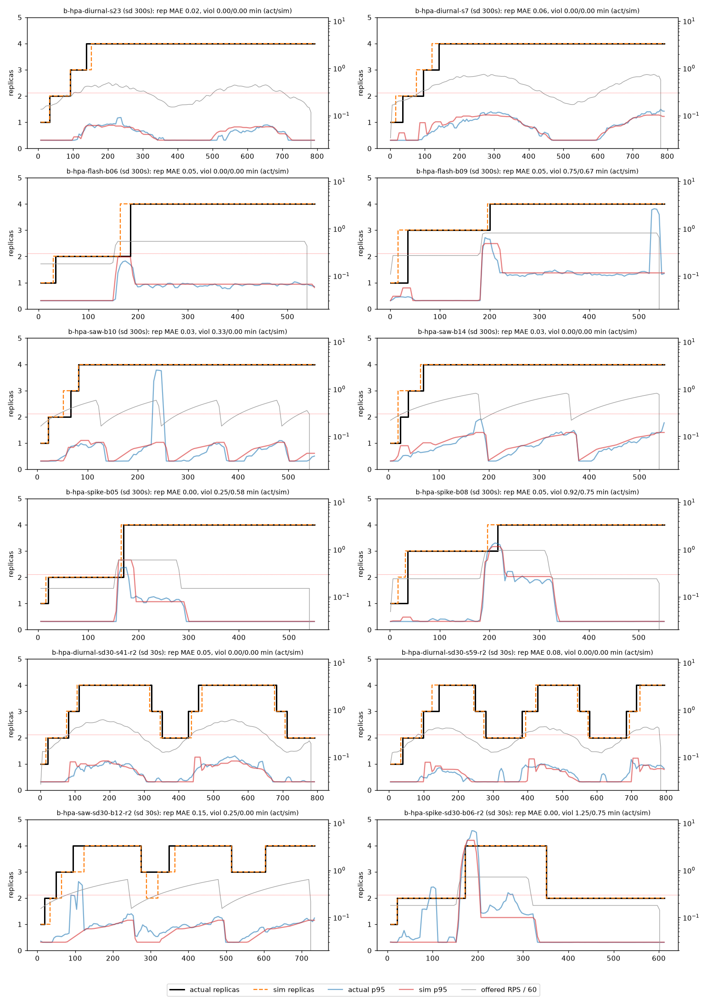

# Replay simulator for autoscaling policies

**Date:** 2026-11-08. **Data:** loadlab dataset, round 1 (24 runs) plus the round-2 runs collected so far (`loadlab/data/`).
**Reproduce:** `cd ml_service && PYTHONPATH=. python -m kubeai_ml.scaling.eval_policies` (about 2.5 min). Tests: `pytest tests/test_simulator.py`.

The simulator scores scaling policies offline: fixed-N, the stock HPA (300 s and 30 s scale-down windows), a tuned HPA, and predictive policies. It replays the offered load of the lab runs, or synthetic shapes, against a pod model fitted on the dataset. It reports SLO-violation minutes, pod-minutes, scaling actions, max replicas and time to recover after spikes. The model is checked against what actually happened in the lab.

## Headline validation numbers

HPA (cpu 70 %) is replayed on every group-B run with the run's own spec: start at 1 replica, max 4, and the run's scale-down window. The round-1 runs use the default 300 s window and never scale in. The round-2 runs use a 30 s window and contain all 11 scale-ins in the dataset.

Two calibrations are reported:

* **Shipped calibration** (`models/scaling/sim_calibration.json`).
  * The pod model is fitted on round 1 only.
  * The metrics-server timing is fitted on all 12 B runs. The fit gives a lag of 10 s and a window of 5 s, which is close to the first-principles 15 s metrics-server resolution.
  * The policy comparison uses this calibration.
* **Strict hold-out.**
  * The timing is fitted on 4 round-1 runs only (lag 15 s, window 20 s).
  * The other 4 round-1 runs and all round-2 runs are never seen in fitting.
  * This is the honest generalisation number.

| metric | R1 B, 8 runs, sd 300 s (shipped) | R2 B, 4 runs, sd 30 s (shipped) | R1 test, 4 runs (strict) | **R2 hold-out (strict)** |
|---|---|---|---|---|
| replica MAE, 1 s resolution vs actual rescales | **0.037 pods** | **0.068** | 0.073 | 0.254 |
| rows with exactly the right replica count | 95.7 % | 92.0 % | 94.2 % | 78.9 % |
| rescales actual / sim / matched (same size, ±120 s) | 20 / 20 / 19 | 30 / 32 / 30 | 10 / 10 / 9 | 30 / 31 / 30 |
| mean \|Δt\| of matched rescales | 7.0 s | 5.2 s | 16.2 s | 24.5 s (sim late) |
| scale-downs actual / sim, \|Δt\| | – | 11 / 12, **0.7 s** | – | 11 / 12, 23.8 s |
| SLO-violation minutes, actual vs sim | **2.25 vs 2.00** | 1.50 vs 0.75 | 1.00 vs 2.17 | 1.50 vs 1.08 |
| per-run absolute error in violation minutes | 0.11 min | 0.19 min | 0.29 min | **0.10 min** |
| pod-minutes error | **1.0 %** | 1.8 % | 2.2 % | 3.0 % |
| p95 error, mean \|log(sim/actual)\| | 0.14 (about ×1.15) | 0.20 | 0.21 | 0.24 |
| CPU utilisation (of request) MAE | 0.079 | 0.088 | 0.093 | 0.122 |

Other checks:

* With the HPA sync phase unknown (averaged over phases 0, 5 and 10 s), the R1 replica MAE is 0.041 and the violation minutes are 2.39 against an actual 2.25.
* With first-principles timing (15 s lag, 15 s window), the R1 replica MAE is 0.042 and the violation minutes are 3.25.
* The timing fit is flat on round 1: every lag + window between 15 and 35 s scores within 0.03 pods. Round 2 is what pins it down (see `sim_results/ms_timing_grid.csv`):

| lag + window (s) | R1 replica MAE | R2 replica MAE |
|---|---|---|
| 10 + 5 (shipped) | 0.037 | 0.068 |
| 10 + 10 | 0.028 | 0.095 |
| 15 + 20 (strict fit) | 0.048 | 0.254 |

**What the strict hold-out says.** Out of sample, the simulator gets every rescale level and direction right: 30 of 30 actual rescales were matched, with one extra simulated 3 → 2 → 3 dip in `saw-sd30-b12`. Violation minutes are within 0.1 min per run. However, the timing fitted on round 1 scales one or two HPA syncs (about 25 s) too late on round 2.

The cause is controller timing, not the pod model:

* Round 2 burns about 7 % more CPU per request: 27.9 vs 26.2 ms, from the OLS fit on fault-free rows. That is node drift.
* Plugging round-2's CPU cost into the round-1 model moves the R2 replica MAE only from 0.30 to 0.29. Shortening the metric lag moves it to 0.13.

Round 1 cannot tell a 15 s lag from a 35 s lag because its rescales are all scale-ups from saturation, where the CPU signal pins at its cap. Scale-in timing is only identifiable with round-2-style runs.

Two simulator bugs were found and fixed while validating against round 2:

1. **Kubernetes event deduplication.** Identical events, such as a second "New size: 4", are merged into one event with `count` > 1. Reading only `firstTimestamp` lost 15 of the 30 round-2 rescales.
   * Actual rescales now come from `runlogs.rescales_from_rows()`. Every `replicas_desired` change in the 5 s rows counts, and its time is refined to the HPA event time when one exists.
   * Round-1 numbers are unchanged, because round 1 has no repeats.
2. **Stabilisation-window boundary.** The HPA keeps scale-down recommendations strictly after `now − window` (Kubernetes uses `timestamp.After(cutoff)`). The simulator kept the boundary sample too, which made every scale-in exactly one sync (15 s) late.
   * After the fix, the scale-in timing error is 0.7 s.

Error direction: violation minutes are slightly under-counted on round 2 (0.75 vs 1.5 min). The misses are short p95 blips at moderate load, around t ≈ 100 s in `spike-sd30-b06` and `saw-sd30-b12`, with p95 at 0.3–0.6 s for 2–3 rows. The steady-state latency curve does not produce them. Use the simulator to rank policies, not to promise an absolute number of minutes.

### Pod model alone (fixed-N replay of the A and C runs, no controller)

| run | N | violation min actual / sim | rows agree | p95 \|log err\| | goodput MAPE | error-rate MAE |
|---|---|---|---|---|---|---|
| a-cap-fixed1 | 1 | 2.17 / 2.33 | 97.6 % | 0.24 | 0.35* | 0.043 |
| a-cap-fixed2 | 2 | 3.00 / 3.08 | 98.8 % | 0.13 | 0.14 | 0.051 |
| a-cap-fixed3 | 3 | 3.83 / 4.33 | 92.9 % | 0.19 | 0.17 | 0.057 |
| c-over-fixed4-steady | 4 | 0 / 0 | 100 % | 0.01 | 0.04 | 0 |
| c-under-fixed1-diurnal | 1 | 4.83 / 5.50 | 94.6 % | 0.23 | 0.14 | 0.075 |
| c-under-fixed2-spike | 2 | 2.67 / 2.83 | 98.2 % | 0.08 | 0.15 | 0.024 |
| **round 1 total** | | **16.5 / 18.1** | **97.0 %** | 0.15 | 0.16 | |
| c-over-fixed4-diurnal-r2 (hold-out) | 4 | 0 / 0 | 100 % | 0.01 | 0.03 | 0 |
| c-under-fixed1-flash-r2 (hold-out) | 1 | 5.75 / 5.75 | 100 % | 0.08 | 1.23* | 0.069 |

\* The MAPE is high only on the deep-overload rows, where goodput is about 1–2 RPS. In `c-under-fixed1-flash-r2`, 27 RPS hits 1 pod, which is 1.4× its ceiling. The real pod collapses to about 1.6 RPS of goodput at an error rate of 0.94. The simulator collapses to 4.2 RPS at an error rate of 0.85. Both are deep SLO breaches, and the violation minutes match exactly.

## How it works

### Offered load (`traces.py`)

* The k6 driver is open loop (`ramping-arrival-rate`), so the offered rate is known exactly.
  * Every run's `k6_summary.json` stores the shape points (`data.loadlab.points`).
  * `shape_points()` is a line-for-line Python port of `load/shapes.js`, including the mulberry32 PRNG used by `diurnal`. It reproduces the recorded points of all 24 round-1 runs and all 12 round-2 runs checked exactly.
  * Synthetic traces use the same function.
* k6 executes the points as linear stages, with targets rounded to whole requests per minute. The trace keeps that rounding.
* Alignment to the dataset clock:
  * `fit_offset` matches a trailing 20 s mean of the offered rate (what `rate(...[20s])` sees) to the observed `rps` on unsaturated rows.
  * Fitted offsets are between −2 and +3.5 s.
* Cross-check: MAPE between the reconstructed rate and the observed rps on unsaturated rows is **0.8–3.7 %** across all runs.

### Pod model (`podmodel.py`, fitted by `fit_pod_model` on round 1, saved to `models/scaling/sim_calibration.json`)

| parameter | value | how it was measured |
|---|---|---|
| CPU per request | **26.2 ms**, plus 8 m idle per pod | OLS of `cpu_cores_used` on `goodput_rps`, stable fault-free unsaturated rows. Round 2 gives 27.9 ms plus 13 m (node drift). |
| per-pod throughput ceiling μ(n) | **19.3 / 17.7 / 17.4 RPS** for 1 / 2 / 3 pods | median goodput per pod with in-flight > 4 per pod. For n > 3 the trend is extrapolated: 16.5 at 4, floor 70 % of μ(1). The node is shared, so per-pod capacity falls with n. |
| steady p95 = f(RPS per pod, n) | empirical curve per n | median p95 in 2-RPS bins on rows where replicas are steady for 30 s and the 20 s RPS has CV < 6 %. Monotone, log-linear interpolation up to 0.6 s at ρ = 1. For n > 4 the n = 4 curve is used. |
| pod startup (scale decision → Ready and taking traffic) | **10 s** | ReplicaSet `SuccessfulCreate` event → first `ready == 1` in pods.csv: median 9 s, p90 14 s, 41 pods; +1 s for endpoints. kube-state-metrics shows desired → ready as 0–10 s, but it reads short because `spec.replicas` itself appears late. |
| server deadline | 10 s | app `REQUEST_TIMEOUT_S` |
| congestion-collapse goodput | **0.22 × capacity** | median goodput / capacity on rows with p95 at the 10 s deadline and error > 0.5 |

The curve is what makes the latency knee move with replica count. The 20 / 18 / 16 RPS-per-pod knees for 1 / 2 / 3 pods are learned from data, not hard-coded:

| RPS per pod | 8 | 12 | 14 | 16 |
|---|---|---|---|---|
| p95, n=1 | 0.03 | 0.03 | 0.03 | 0.034 |
| p95, n=2 | 0.03 | 0.067 | 0.12 | 0.22 |
| p95, n=3 | 0.055 | 0.10 | 0.34 | 0.47 |
| p95, n=4 | 0.066 | 0.11 | 0.23 | 0.49 |

The largest RPS per pod that keeps p95 under 200 ms is 18.6, 15.6, 13.1 and 13.6 for 1, 2, 3 and 4 pods. Under 300 ms it is 18.8, 16.5, 13.8 and 14.7.

#### Queue and overload

The simulator keeps a FIFO fluid queue of arrival cohorts:

* Queueing delay is the backlog divided by capacity.
* Cohorts older than 10 s get a 504 and leave the queue.
* Congestion collapse: once the queue head reaches the deadline, the pods enter collapse.
  * CPU stays at the limit, but only about 22 % of the work finishes in time. The rest also ends as 504.
  * This matches the data. In a-cap-fixed1 the CPU is at 0.5 cores while goodput is about 2 RPS at error 0.9: `asyncio.wait_for` cancels the coroutine, not the worker thread.
* After the load drops, the queue drains at capacity minus the offered rate. The c-under-fixed2-spike recovery (about 25 s) is reproduced.

A first version without the collapse and timeout terms over-predicted goodput 3× under overload, with a goodput MAPE of 0.51.

### Measurement and controller timing (`simulator.py`, `hpa.py`)

* **Observed signals** use the dataset's windows:
  * rps, goodput, error rate and p95 over 20 s. p95 is the window max, and it is forced to 10 s when more than 5 % of responses are 504s, because 504s are recorded at the deadline.
  * CPU over 20 s.
  * Policies receive these columns under the dataset's names, so the real feature pipeline can run unchanged.
* **metrics-server view for the HPA**: mean ready-pod CPU utilisation over [t − lag − window, t − lag].
  * The shipped fit on all 12 B runs gives **lag 10 s, window 5 s**.
  * The strict fit on 4 round-1 runs gives 15 s and 20 s; see the hold-out discussion above.
* **HPA sync phase**: 15 s period, phase taken from the run's HPA events (`event time mod 15`, using both first and last timestamps of deduplicated events).
* **HPA algorithm**: kube-controller-manager `GetResourceReplicas` plus the default `behavior`:
  * 10 % tolerance;
  * desired = ceil(ratio × pods with a metric);
  * pods that are missing a metric or not ready count as 0 % on scale-up and 100 % on scale-down, and the recomputation is dropped if it flips direction;
  * scale-up has no stabilisation and is limited to max(+100 %, +4 pods) per sync;
  * scale-down takes the max recommendation over the stabilisation window, keeping samples strictly newer than `now − window`. The window is 300 s by default, with a 30 s variant (round-2 runs, `HPAPolicy(scale_down_window_s=30)`);
  * results are clamped to min/max.
* Actual rescales for validation come from `runlogs.rescales_from_rows()`: the `replicas_desired` changes, refined to HPA event times.

### Policy plug-in interface

See the docstring of `simulator.py`. A policy has the following attributes:

* `name`;
* `period_s`;
* `phase_s`;
* `reset()`;
* `__call__(history_df_upto_t, state) -> int`.

`history` holds observable rows only, with no `true_*` columns (a test checks this). `state` carries:

* spec replicas;
* per-pod readiness ages;
* the metrics-server CPU utilisation;
* min/max;
* the `PodModel`.

`CallablePolicy(fn)` wraps a plain function. `sim_policies.load_agent_policy()` plugs in `kubeai_ml.scaling.policy` automatically, choosing the first entry point that is available:

1. a `sim_policy(model) -> Policy` factory, if the module has one;
2. a 2-argument `desired_replicas(history, state)`;
3. `AgentPolicyAdapter`, around the actual `desired_replicas(forecast_q90, capacity, current, bounds, stabilization, *, state, now_rps, cpu_per_req_s, ts, memory)`.

`AgentPolicyAdapter` works as follows:

* Capacity is the trained `CapacityModel` from `models/scaling/capacity.json`.
* cpu per request is computed from the history.
* The state is always `healthy`, because the traces carry traffic only.
* The forecast is, for now, a trend extrapolation of the saturation-robust demand estimate. To use the trained LightGBM quantile forecaster, pass `forecast_fn(history, step_s) -> {60: q90, 120: q90, 300: q90}`.

The comparison includes the adapter as `agent-policy`, plus a self-contained reference predictive policy (`predictive-ref`, with surge headroom 1.0 and 1.5).

## Policy comparison (shipped calibration)

The comparison uses 23 traces:

* 12 B runs (round 1 and round 2);
* 5 C runs;
* 2 E runs (load only; faults are not simulated);
* 4 longer synthetic shapes:
  * a 30 min diurnal;
  * a 5× spike followed by 18 min of quiet;
  * a 4× flash crowd;
  * a 4 min sawtooth.

In total that is about 230 trace-minutes. HPA and predictive policies start at 1 replica. Totals are summed over all traces.

**Max 4 replicas (lab cap):**

| policy | SLO-viol min | pod-min | actions | TTR after spike max / mean (s) | requests 504 % |
|---|---|---|---|---|---|
| fixed-4 | 0.0 | 1173 | 0 | 0 / 0 | 0 |
| hpa-70-sd30 | 5.7 | 899 | 137 | 60 / 17 | 0 |
| hpa-70-sd300 (stock) | 5.7 | 1002 | 63 | 60 / 17 | 0 |
| **agent-policy** (policy.py + trained capacity, trend forecast) | 6.0 | **893** | 80 | 65 / 20 | 0.27 |
| predictive-ref-h1.5 | 10.2 | 862 | 127 | 85 / 28 | 0.27 |
| predictive-ref | 14.8 | 691 | 125 | 110 / 36 | 1.27 |
| fixed-3 | 30.0 | 880 | 0 | 300 / 43 | 2.21 |
| hpa-tuned-146-sd300 | 32.1 | 724 | 60 | 155 / 53 | 5.66 |
| hpa-tuned-146-sd30 | 42.7 | 577 | 125 | 155 / 58 | 5.66 |
| fixed-2 | 73.6 | 587 | 0 | 300 / 73 | 17.2 |

**Max 8 replicas.** For n > 4 the pod model is extrapolated (see limitations).

| policy | SLO-viol min | pod-min | actions | max reps | TTR max / mean (s) | 504 % |
|---|---|---|---|---|---|---|
| fixed-4 | 0.0 | 1173 | 0 | 4 | 0 / 0 | 0 |
| fixed-6 | 0.0 | 1760 | 0 | 6 | 0 / 0 | 0 |
| **agent-policy** | **5.3** | 1174 | 125 | 8 | 55 / 18 | 0.28 |
| hpa-70-sd30 | 5.4 | 1093 | 214 | 8 | 60 / 17 | 0 |
| hpa-70-sd300 (stock) | 5.4 | 1396 | 104 | 8 | 60 / 17 | 0 |
| predictive-ref-h1.5 | 7.6 | 1099 | 188 | 8 | 50 / 22 | 0.22 |
| predictive-ref | 11.8 | 832 | 153 | 8 | 60 / 30 | 0.79 |
| hpa-tuned-146-sd300 | 31.7 | 761 | 69 | 6 | 145 / 52 | 5.66 |

Per-trace tables are in `sim_results/policy_comparison_per_trace.csv`. The trade-off plot is `plots/sim_policy_tradeoff.png`.

### What the comparison says

1. **The stock HPA (70 % of a 250m request, about 6.7 RPS per pod) is safe because it over-provisions.**
   * It still breaks the SLO for about 0.5–1 min on every 3–4× spike, because it reacts about 25 s late: 15 s of metric lag and window, up to a 15 s sync, and 10 s of startup.
   * It holds a 2.7× capacity margin (18 / 6.7) the rest of the time.
   * The 300 s scale-down window costs pod-minutes with zero SLO benefit on these traces: +11 % with max 4 and +28 % with max 8, compared with a 30 s window. Round 2 confirms in the lab that sd30 scales in cleanly with no extra violations.
2. **A CPU-target HPA cannot be tuned up to the learned capacity.**
   * At target 146 %, the CPU of 13.6 safe RPS per pod at n = 4, the ratio saturates: CPU is capped at the 500m limit, which is 200 % of request, so the ratio is at most 1.37. The HPA then adds only about one pod per sync while the pods are in collapse.
   * It produced 5.6–7.5× more violation minutes and 5.7 % 504s.
   * The CPU-utilisation signal goes blind exactly when it is needed. This is the main argument for a capacity- and RPS-based policy over "just raise the HPA target".
3. **The decision engine's policy (`policy.py`) is on a par with a well-configured HPA, and it is not yet better.**
   * With max 4 it has the same SLO as the HPA (6.0 vs 5.7 min) at −11 % pod-minutes against the stock sd300 and about −1 % against sd30.
   * With max 8 it has slightly fewer violation minutes (5.3 vs 5.4) and a faster worst-case recovery (55 vs 60 s). Its cost is −16 % against stock and +7 % against sd30.
   * **Correction to the earlier version of this note:** it reported "−55 % violation minutes against the stock HPA". That came from the slower 35 s metric timing fitted on round 1 only. Round 2 showed the real HPA reacts about 20 s faster, and with the corrected timing the advantage disappears.
   * The levers left for `policy.py` are:
     * a better forecast than the placeholder trend (pass the trained forecaster);
     * a faster first reaction to a rising sample, since the agent sees the 20 s rps window and the HPA sees a 15 s CPU lag;
     * the 180 s down-window and 85 % down-headroom, which are its cost knobs.
4. **Capacity-aware sizing without a margin loses on spikes.** `predictive-ref` is 23–40 % cheaper than the HPA but has 2.2–2.6× the violation minutes. `predictive-ref-h1.5` sits in between. 10 s of startup plus 20 s of metric windows cannot be predicted away from the load series alone on step-shaped load.
5. **Nothing reactive gets to zero violations on a 4× step; only over-provisioning does** (fixed-4: 0 min at 1.3× the pod-minutes of the sd30 HPA). This bounds what a better forecaster can win on step-shaped load. It can still win on ramps and diurnal load, where all autoscaled policies already have 0 violations, by doing it with fewer pods.

## Limitations

* Only traffic is simulated. Faults (leak, dependency latency, bad deploy, CPU hog and so on) are not. Scaling under faults is the decision engine's gate ("do NOT scale") and is evaluated by the classifier, not here.
* The pod model is calibrated for n ≤ 4.
  * For n > 4, μ(n) is extrapolated from the 1–3 pod trend: 16.5, 15.6 and 14.7 RPS for 4, 5 and 6 pods.
  * The latency curve reuses n = 4.
  * Runs with a higher lane cap would fix this. Re-running `eval_policies` refits everything from `dataset_deploy`; `--fit-rounds 1,2` fits the pod model on both rounds.
* Controller timing drifts between sessions. Round 1 alone cannot identify it, because its rescales are all scale-ups from saturation, where the CPU signal pins at its cap. Round 2 pins it to about 15 s total. On a real cluster, refit it from that cluster's HPA events.
* CPU per request drifted +7 % between rounds on the same image (node noise). That drift hardly moves the HPA replay, but it is a reason to learn cost per request online.
* Short p95 blips at moderate load (0.3–0.6 s, 10–15 s long) are missed. Round-2 violation minutes are under-counted by about 0.2 min per run.
* Collapse depth is a constant (0.22 × capacity). Under 1.4× overload on 1 pod, the real goodput is lower: 1.6 vs 4.2 RPS.
* Load is balanced evenly across ready pods (k6 opens a new connection per request), and the queue is pooled, not per pod.
* The windowed p95 is approximated by the max of the 5 s values.
* The node runs on a 6-CPU minikube with k6 and Prometheus co-located. That is why μ and the knee depend on n. A real cluster would need recalibration (run `fit_pod_model` on its data).

## Files

| file | role |
|---|---|
| `traces.py` | shapes.js port, k6 points → offered rate, clock alignment, synthetic traces |
| `podmodel.py` | `PodModel` and its fit (CPU cost, μ(n), latency curve, collapse, startup) |
| `runlogs.py` | k8s events: HPA rescales (dedup-aware) and sync phase, pod startup delays, `rescales_from_rows` |
| `simulator.py` | 5 s loop, queue, measurement windows, policy interface, scoring (`summarize`) |
| `hpa.py` | k8s HPA algorithm as a policy (sd 300 s / 30 s) |
| `sim_policies.py` | tuned HPA, reference predictive policy, `policy.py` adapter, default policy set |
| `eval_policies.py` | calibration → validation (shipped and strict) → comparison CLI |
| `sim_results/validation_hpa_B.csv` | per-run HPA replay with the shipped calibration |
| `sim_results/validation_hpa_B_strict.csv` | the same with the strict hold-out calibration |
| `sim_results/validation_fixed_AC.csv`, `ms_timing_grid.csv`, `policy_comparison_*.csv`, `summary.json` | other results |
| `../../models/scaling/sim_calibration.json` | fitted pod model, shipped and strict metrics-server timing |
| `../../tests/test_simulator.py` | happy-path tests: shape port, fixed-N bracket, HPA scale-up, sd30 scale-in, no ground-truth leak |
